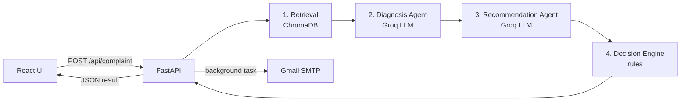

# CampusFix AI

**An agentic AI assistant for campus maintenance.**
Report a problem in plain language (with an optional photo) and CampusFix finds similar past cases, generates a diagnosis and a recommended fix, sets a priority, and emails the maintenance authority.

> Built with FastAPI, LangGraph, ChromaDB, Groq and React.

---

## Features

- **Natural-language complaints**: describe the issue and its location; attach a JPG, PNG or WEBP photo (max 5 MB).
- **Retrieval-augmented diagnosis**: finds the 3 most similar historical maintenance cases in a ChromaDB vector store.
- **Two-agent LLM pipeline**: a Diagnosis Agent (likely cause, evidence, confidence, safety concern) and a Recommendation Agent (action, cost, repair time, urgency, precautions).
- **Rule-based decision engine**: assigns urgency and priority, flags cases that need a human, and escalates safety hazards.
- **Email notification**: sends the authority a summary with the photo attached (runs in the background, so it never blocks the user).
- **Dashboard UI**: live stats, results cards, complaint history and a searchable maintenance-records table.

## How it works



The four steps run as a LangGraph state graph that shares one state object (complaint, retrieved cases, diagnosis, recommendation, activity log, decision).

## Tech stack

| Layer | Technology |
|---|---|
| Backend | Python 3.12, FastAPI, Uvicorn |
| Orchestration | LangGraph, LangChain |
| LLM | Groq (`openai/gpt-oss-20b`) |
| Vector store | ChromaDB (default local embeddings) |
| Frontend | React 19, Vite, lucide-react |
| Email | Gmail SMTP (STARTTLS) |

## Project structure

```
campusfix/
├── campusfix-ai/                 # Backend
│   ├── app/
│   │   ├── main.py               # FastAPI app, endpoints, uploads, email
│   │   ├── graph.py              # LangGraph pipeline + decision engine
│   │   ├── agents.py             # Diagnosis and Recommendation agents
│   │   ├── rag.py                # ChromaDB retrieval
│   │   ├── ingest.py             # Loads the JSON records into ChromaDB
│   │   └── test_groq.py          # Groq connectivity check
│   ├── data/maintenance_records.json
│   ├── requirements.txt
│   └── .env.example
└── campusfix-frontend/           # React + Vite dashboard
    └── src/App.jsx
```

## Getting started

### Prerequisites

- Python 3.12
- Node.js 20.19+ (or newer)
- A [Groq API key](https://console.groq.com)
- *(Optional, for email)* a Gmail account with 2-step verification and an [app password](https://myaccount.google.com/apppasswords)

### 1. Backend

```bash
cd campusfix-ai
python3 -m venv venv
source venv/bin/activate          # Windows: venv\Scripts\activate
pip install -r requirements.txt

cp .env.example .env              # then edit .env with your own values
python -m app.ingest              # builds the ChromaDB index (run once)
uvicorn app.main:app --reload     # http://127.0.0.1:8000
```

Interactive API docs are available at <http://127.0.0.1:8000/docs>.

### 2. Frontend

```bash
cd campusfix-frontend
npm install
npm run dev                       # http://localhost:5173
```

Open <http://localhost:5173>, enter a location and a problem, and click **Analyse with CampusFix AI**.

## Configuration

Create `campusfix-ai/.env` (never commit this file):

| Variable | Description |
|---|---|
| `GROQ_API_KEY` | Groq API key (required) |
| `MAIL_USER` | Gmail address used to send notifications |
| `MAIL_PASS` | Gmail **app password** (not your normal password) |
| `AUTHORITY_EMAIL` | Recipient of complaint emails |

If the three mail variables are not set, email is skipped and everything else still works.

## API

| Method | Path | Description |
|---|---|---|
| `GET` | `/` | Health check |
| `GET` | `/api/maintenance-records` | List the seed maintenance records |
| `POST` | `/api/complaint` | Analyse a complaint |

**Analyse a complaint**

```bash
curl -X POST http://127.0.0.1:8000/api/complaint \
  -F "location=Physics Lab" \
  -F "complaint=The electrical socket is sparking" \
  -F "image=@photo.jpg"          # optional
```

The response contains `diagnosis`, `recommendation`, an `activities` log of each pipeline step, and a `decision` object:

```json
{
  "urgency": "Critical",
  "priority": "Emergency",
  "next_action": "Potential immediate safety hazard reported. ...",
  "human_intervention_required": true
}
```

## Decision engine

| Urgency | Priority | Human needed |
|---|---|---|
| Critical | Emergency | Yes |
| High | High Priority | Yes |
| Medium | Normal Priority | No |
| Low | Low Priority | No |
| Unclear / possible hazard | Manual Review | Yes |

Urgency comes from the recommendation agent's output, combined with keyword checks on the complaint for hazards such as sparking, smoke, fire or exposed wires.

## Known limitations

- The knowledge base has only 12 seed records, so cost and time estimates are rough and out-of-scope complaints may get weak matches.
- The uploaded photo is attached to the email but not analysed by the AI.
- Complaint history is stored in the browser (`localStorage`), not on the server.
- There is no authentication or rate limiting. Do not expose the API publicly as-is.
- Urgency parsing relies on the LLM's text format and keyword rules, so it can miss unusually worded hazards. Safety-critical repairs must always be verified by qualified personnel.

## Roadmap

- [ ] Structured (JSON) LLM output for urgency and a safety flag
- [ ] Persistent complaint storage with status tracking (open, assigned, resolved)
- [ ] Relevance threshold for retrieval and a larger dataset
- [ ] Image analysis with a vision model
- [ ] Authentication, rate limiting and deployment configuration
- [ ] Automated tests for the decision engine

## Security notes

- Keep `.env` out of version control (it is listed in `.gitignore`).
- If a key or password is ever shared or committed by accident, rotate it immediately.

## License

Add a license of your choice (for example MIT) before sharing publicly.
